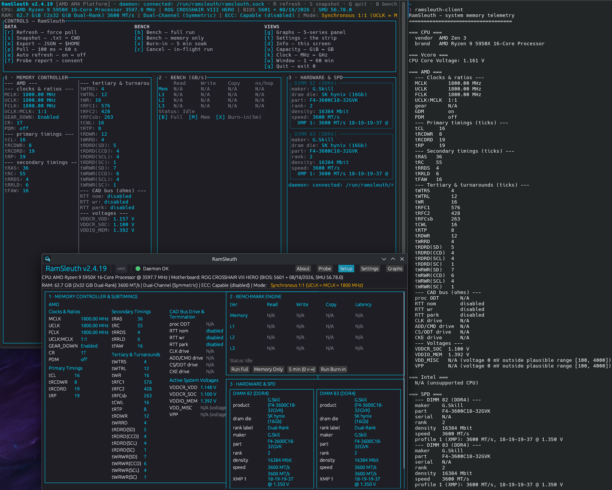

# RamSleuth

See what your memory controller is actually doing — live.



[](LICENSE)
[](https://github.com/MadGoatHaz/RamSleuth/releases)
[](https://github.com/MadGoatHaz/RamSleuth)

## What it is

RamSleuth is a live memory-controller telemetry suite and a native Memory &
Latency Benchmark for AMD and Intel PC RAM. It reads the memory controller's
actual operating state — clocks, trained DRAM subtimings, voltages, channel
mode, ECC — not just the SPD label on your DIMMs.

Built in pure Rust with a single small-capability privileged daemon and
unprivileged clients (GUI, TUI, CLI). No-panic by design: missing drivers,
privileges, or hardware degrade to structured `N/A (<reason>)` fields, exit 0.

## Features

- **Live AMD telemetry** — Zen 1–6 (DDR4/DDR5), Threadripper/TRX40 via APOB
  - 27 DRAM subtimings, CAD bus, 5 voltage rails
  - PM-table clocks (MCLK/UCLK/FCLK), GDM, command rate
  - Threadripper/TRX40: APOB firmware structure (live SMN not updated on sIOD)
  - Channel mode, ECC, live vCore
- **Live Intel telemetry** — Skylake → Arrow Lake (DDR4/DDR5), server/HEDT via
  SMBIOS+SPD
  - Trained subtimings from IMC registers
  - Channel mode: 4-tier hardware cross-check
  - ECC from host-bridge CAPID0_A
  - vCore from Super-I/O (confidence-badged)
  - Server/HEDT: SMBIOS+SPD (live MC registers are CPU-internal)
- **Unprivileged SPD decode** — JESD79-4 (DDR4) / JESD79-5 (DDR5)
  - Module & DRAM die maker (JEP106), rank, bus width, part, serial
  - JEDEC base speed + XMP 2.0 (DDR4) / XMP 3.0-EXPO (DDR5) profiles
- **Memory & Latency Benchmark** — native 4×4 grid (DRAM/L1/L2/L3 × Read/Write/Copy/Latency)
  - AVX2/AVX-512F kernels, one worker per physical core
  - Pointer-chase latency + optional burn-in soak
- **Dual frontend** — egui desktop GUI + 17-key ratatui terminal UI
  - Live three-zone dashboard, 5-series graphs, PNG/JSON export
- **One-line RAM summary** — size, speed, channel mode, ECC, clocking
- **Consent-gated probe report** — system identity, decoded readout, N/A reasons, raw register dump
  - One-click Open GitHub Issue (GUI) or `~/.ramsleuth/probe-report.md` (TUI)

## Platform Support

| Platform | Memory | What you get |
| --- | --- | --- |
| AMD Ryzen (Zen 1–6) | DDR4 / DDR5 | Full live SMU telemetry: clocks, 27 subtimings, voltages, channel mode, ECC |
| AMD Threadripper / TRX40 | DDR4 | APOB firmware timings, limited PM table (sIOD SMN not live) |
| AMD EPYC | DDR4 / DDR5 | APOB-based telemetry (server sIOD path) |
| Intel client (Skylake → Arrow Lake) | DDR4 / DDR5 | Full live IMC telemetry: trained subtimings, clocks, channel mode, ECC |
| Intel server / HEDT (Haswell-E → Sapphire Rapids) | DDR4 / DDR5 | SMBIOS+SPD topology; live MC registers are CPU-internal (honest `N/A`) |

**Requirements:** Linux x86_64, kernel 5.4+, systemd.

## The Tools

| Binary | Description |
| --- | --- |
| `ramsleuth` | Desktop GUI (egui) — dashboard, graphs, settings, one-click setup |
| `ramsleuth-tui` | Terminal dashboard (ratatui) — full UI in 17 keys |
| `ramsleuth-client` | Unprivileged CLI — `dump`, `bench`, `status`, `probe`, `burn` |
| `ramsleuth-daemon` | Privileged service — `CAP_SYS_RAWIO` only, Unix-socket IPC |
| `ramsleuth-bench` | Standalone benchmark — 4×4 grid, no daemon required |
| `ramsleuth-telemetry` | Standalone snapshot — full telemetry, no daemon required |

## Installation

### Quick Start (any distro)

```sh
git clone https://github.com/MadGoatHaz/RamSleuth && cd RamSleuth && ./install.sh
```

Downloads the precompiled release binary (no Rust toolchain needed),
installs all 6 binaries + systemd unit + setup helper, and enables the
daemon. Idempotent and safe to re-run.

### AUR (Arch/Manjaro)

Pick exactly one:

```sh
yay -S ramsleuth      # builds from the official release tag
yay -S ramsleuth-bin  # precompiled tarball (fastest)
```

### Debian/Ubuntu (.deb)

Download the `.deb` from the [releases page](https://github.com/MadGoatHaz/RamSleuth/releases), then:

```sh
sudo dpkg -i ramsleuth_amd64.deb
sudo usermod -aG ramsleuth $USER && newgrp ramsleuth
```

Installs the 6 binaries, systemd unit, setup helper, polkit policy, and
enables the daemon.

### Optional: Live Memory Controller Drivers

Without these, everything else still works — only the live MC fields
read `N/A (DriverMissing)`.

- **AMD** — the `ryzen_smu` driver is bundled; the one-click setup builds it
  from vendored source offline.
- **Intel** — `yay -S ramsleuth-intel-dkms` (AUR) or the in-app one-click
  setup builds RamSleuth's own `ramsleuth_intel` module via DKMS.

### Build from Source

```sh
cargo build --workspace --release
```

Rust MSRV 1.75. Produces the 6 binaries above.

## Quick Start (first run)

1. **Install** using any method above.
2. **Launch** — run `ramsleuth` (GUI) or `ramsleuth-tui` (terminal).
3. **One click** — the first-launch `SETUP` strip enables the daemon, adds
   your user to the `ramsleuth` group, and builds the telemetry driver if
   present. No reboot required.
4. **Read** — the dashboard is live immediately; start a benchmark from the
   GUI, TUI, or `ramsleuth-client bench`.

## Documentation

- [User Guide](Docs/User_Guide.md) — installation, first run, reading the data, troubleshooting
- [Architecture](Docs/Architecture.md) — technical design, daemon protocol, workspace map
- [Packaging & AUR](packaging/README.md) — AUR model, version-bump policy, release artifacts
- [Changelog](CHANGELOG.md) — per-release history

## License

MIT — see [LICENSE](LICENSE).

RamSleuth v2.4.29
